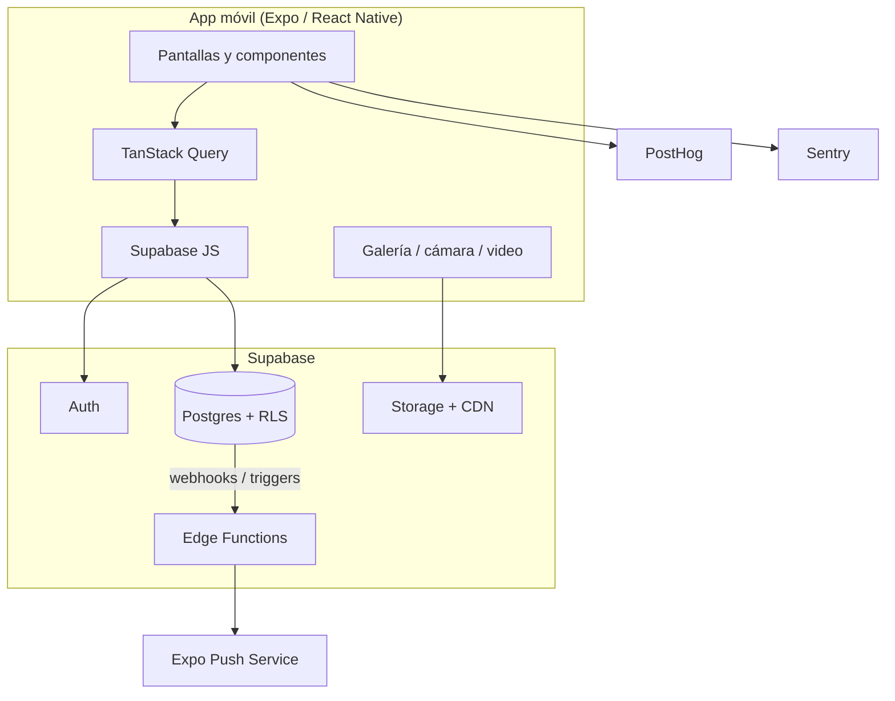

# Arquitectura

> Versión 0.1 · 18/10/2026
> Decisión de stack: [ADR-0001](decisiones/0001-stack-react-native-expo-supabase.md)

## 1. Principios

1. **Un solo repo, un solo backend.** App Expo + Supabase. Sin servidor propio en el MVP.
2. **La seguridad vive en la base.** RLS en todas las tablas; el cliente nunca es confiable.
3. **Lo simple primero.** Consultas directas, sin capa de API propia hasta que duela.
4. **Aburrido y probado.** Tecnologías con comunidad y documentación, no experimentos.
5. **Todo versionado.** Esquema, migraciones, configuración y docs en git.

## 2. Vista general



El cliente habla directo con Supabase usando la clave anónima y el JWT del usuario. Las Edge Functions solo existen para lo que no puede hacer el cliente: enviar push, borrar medios, moderar y tareas programadas.

## 3. Stack

| Capa | Elección | Por qué |
| --- | --- | --- |
| App | React Native + Expo (última SDK estable) | Un código para iOS/Android, builds con EAS, iteración rápida. |
| Lenguaje | TypeScript strict | Menos bugs de contrato entre pantallas y datos. |
| Rutas | Expo Router | Rutas por archivos, deep links y layouts simples. |
| Datos remotos | TanStack Query + Supabase JS | Cache, reintentos, optimistic updates y paginación. |
| Formularios | React Hook Form + Zod | Validación compartida entre cliente y reglas. |
| UI | StyleSheet + tokens propios | Sin dependencia de un kit pesado; control total. |
| Listas | FlashList | Performance en feeds largos. |
| Video | expo-video + expo-camera / expo-image-picker | Reproducción, grabación y selección nativas. |
| Imágenes | expo-image + expo-image-manipulator | Cache, placeholders y compresión antes de subir. |
| Notificaciones | expo-notifications | Push con Expo sin backend propio. |
| Almacenamiento local | expo-secure-store | Tokens de sesión. |
| Backend | Supabase (Postgres, Auth, Storage, Edge Functions) | Auth, RLS, storage y realtime sin operar servidores. |
| Analítica | PostHog | Embudos, retención y feature flags. |
| Errores | Sentry | Crash reporting y tracing básico. |
| Builds | EAS Build / Submit / Update | Builds reproducibles y OTA controlado. |

## 4. Estructura del repositorio

```text
musikate/
├── app/                        # Rutas de Expo Router
│   ├── (auth)/                 # login, código, onboarding
│   ├── (tabs)/                 # feed, avisos, buscar, perfil
│   ├── post/[id].tsx
│   ├── perfil/[username].tsx
│   ├── aviso/[id].tsx
│   └── _layout.tsx
├── src/
│   ├── components/             # UI reutilizable
│   ├── features/
│   │   ├── auth/
│   │   ├── profile/
│   │   ├── posts/
│   │   ├── feed/
│   │   ├── listings/
│   │   └── notifications/
│   ├── lib/                    # supabase, analytics, sentry, media
│   ├── hooks/
│   ├── theme/                  # tokens, tipografía, espaciado
│   └── types/                  # tipos generados y de dominio
├── supabase/
│   ├── migrations/
│   ├── functions/
│   │   └── send-push/
│   └── seed.sql
├── assets/
├── docs/
├── app.json
├── eas.json
└── package.json
```

**No hay monorepo.** Una app y un backend. Si más adelante aparece un panel de administración web, se evalúa separarlo.

## 5. App

### 5.1 Rutas y navegación

- `(auth)`: bienvenida, login, verificación por código, onboarding.
- `(tabs)`: Feed, Avisos, Buscar, Perfil.
- Stack para detalle de post, perfil, aviso, ajustes y reportes.
- Deep links: `musikate://post/:id`, `musikate://u/:username`, `musikate://aviso/:id`, `musikate://auth/callback`.

### 5.2 Estado

- **Servidor**: TanStack Query. Claves por entidad (`posts.feed`, `listings.list`, `profile.byUsername`).
- **Sesión**: contexto de Supabase Auth; tokens en SecureStore.
- **UI local**: estado de componente; Zustand solo si aparece estado global real (por ejemplo, reproducción de video).

### 5.3 Medios

Flujo de subida:

1. Validar duración (≤ 60 s), tamaño (≤ 50 MB) y formato.
2. Comprimir imagen (máx. 1440 px) o video (720p, H.264/AAC) en el dispositivo.
3. Subir a Storage en `covers/{userId}/{postId}.mp4` o `photos/{userId}/{postId}.jpg`.
4. Generar y subir portada del video.
5. Insertar la fila en `posts` con las rutas.
6. Si algo falla, borrar el objeto huérfano y permitir reintentar.

Decisiones:

- Buckets públicos de lectura con nombres UUID no adivinables; escritura restringida a la carpeta del usuario.
- Sin transcodificación en servidor en el MVP. Se limita la calidad en el cliente y se prueba en Android de gama media.
- Si el video se vuelve un problema (codecs, peso, egress), se migra a Mux o Cloudflare Stream (fase 2).

### 5.4 Feed

Consulta base de "Siguiendo":

```sql
select p.*, pr.username, pr.display_name, pr.avatar_path
from posts p
join profiles pr on pr.id = p.author_id
where p.deleted_at is null
  and (
    p.author_id = auth.uid()
    or p.author_id in (select following_id from follows where follower_id = auth.uid())
  )
  and not is_blocked(auth.uid(), p.author_id)
order by p.created_at desc, p.id desc
limit 20;
```

`is_blocked(a, b)` revisa el bloqueo en ambas direcciones y es `security definer` para no depender de las políticas de `blocks`. Paginación por cursor `(created_at, id)`, no por offset. "Descubrir" usa la ciudad del perfil y los últimos 7 días, excluyendo bloqueados y opcionalmente cuentas ya seguidas.

### 5.5 Búsqueda

- Perfiles: `pg_trgm` sobre `username` y `display_name`, más filtros por instrumento y género.
- Avisos: filtros por tipo, instrumento, género y zona; orden por fecha.
- Sin motor externo. Si la búsqueda se vuelve lenta, se agrega `tsvector` o un servicio dedicado.

### 5.6 Notificaciones

1. Un trigger inserta en `notifications` al ocurrir follow, like, comment o interés.
2. Un webhook de base de datos llama a la Edge Function `send-push`.
3. La función valida el secreto, busca los tokens del destinatario y llama a Expo Push.
4. Los tokens inválidos se marcan para limpieza.

La función nunca se llama desde el cliente. Los tokens se registran desde la app con `expo-notifications`.

### 5.7 Moderación

- Reportes y bloqueos en base; el contenido bloqueado se filtra en las consultas y en RLS.
- Moderación manual desde Supabase Studio durante la beta (tabla `reports` + estados).
- Panel propio, moderación automática de texto/imagen y verificación de artistas: fase 2/3.
- Requisitos de App Store: filtro de contenido objetable, reporte, bloqueo y datos de contacto publicados.

## 6. Seguridad

- **RLS activo en todas las tablas.** Sin política, sin acceso.
- El cliente solo usa la clave anónima; la `service_role` vive exclusivamente en Edge Functions.
- Storage: políticas por carpeta (`auth.uid()`), lectura pública solo para avatares, covers y fotos.
- Límites anti-abuso en triggers y en Edge Functions (posts, comentarios, follows, avisos).
- Validación de entrada en cliente (Zod) y en base (constraints); nunca confiar en una sola capa.
- Secretos en EAS Secrets y Supabase Vault; `.env.local` fuera de git.
- Backups diarios en Supabase Pro; prueba de restauración antes de la beta.

## 7. Entornos y despliegue

| Entorno | App | Backend | Uso |
| --- | --- | --- | --- |
| Local | Expo dev build | Supabase local (Docker) o proyecto dev | Desarrollo diario |
| Preview | EAS `preview` | Proyecto dev | Pruebas con testers |
| Producción | EAS `production` | Proyecto prod | Beta y lanzamiento |

- Migraciones siempre por archivo (`supabase/migrations`), nunca cambios manuales en prod.
- `main` se mantiene desplegable; los builds de producción salen de tags.
- EAS Update solo para correcciones de JS; cambios nativos requieren build nuevo.
- Región de Supabase: **São Paulo (sa-east-1)** por latencia desde Uruguay; si no está disponible en el plan, us-east-1.

### CI mínimo (GitHub Actions)

```yaml
name: CI
on:
  pull_request:
  push:
    branches: [main]

jobs:
  quality:
    runs-on: ubuntu-latest
    steps:
      - uses: actions/checkout@v4
      - uses: pnpm/action-setup@v4
        with:
          version: 10
      - uses: actions/setup-node@v4
        with:
          node-version: lts/*
          cache: pnpm
      - run: pnpm install --frozen-lockfile
      - run: pnpm lint
      - run: pnpm typecheck
      - run: pnpm test -- --runInBand
```

## 8. Costos estimados

| Servicio | Costo | Cuándo |
| --- | --- | --- |
| Apple Developer Program | US$ 99/año | Antes de TestFlight |
| Google Play Console | US$ 25 único | Antes de Play Internal |
| Supabase | Gratis en desarrollo; Pro ~US$ 25/mes | Al empezar la beta |
| EAS Build | Gratis con cola; plan pago opcional | Desde el primer build |
| Dominio | US$ 12-20/año | Antes de la beta |
| Sentry / PostHog | Planes gratuitos | Desde el inicio |

Costo de arranque: ~US$ 125-150. Costo mensual en beta: ~US$ 25-45.

## 9. Decisiones técnicas abiertas

- Transcodificación de video: cliente vs Mux/Cloudflare Stream.
- Chat 1:1: Supabase Realtime vs proveedor externo (fase 2).
- Panel de moderación: Supabase Studio vs app interna (fase 2).
- Suscripciones: RevenueCat vs compras nativas directas (fase 3).
- Estrategia de backups y retención de medios borrados.

Ver [Preguntas abiertas](10-preguntas-abiertas.md).
