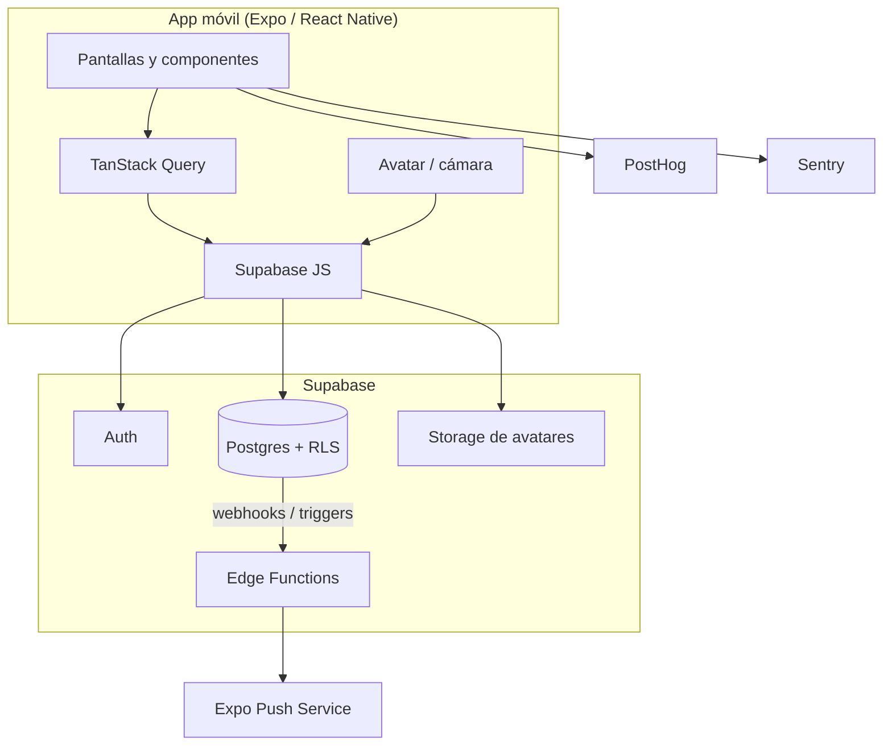

# Arquitectura

> Versión 0.2 · 18/10/2026
> Decisión de stack: [ADR-0001](decisiones/0001-stack-react-native-expo-supabase.md)
> Decisión de entornos: [ADR-0005](decisiones/0005-dos-entornos-develop-prod.md)

## 1. Principios

1. **Utilidad primero.** El MVP resuelve perfiles y avisos; el video es fase 2.
2. **Un solo repo, un solo backend.** App Expo + Supabase. Sin servidor propio.
3. **La seguridad vive en la base.** RLS en todas las tablas; el cliente nunca es confiable.
4. **Lo simple primero.** Consultas directas, sin capa de API propia hasta que duela.
5. **Aburrido y probado.** Tecnologías con comunidad y documentación, no experimentos.
6. **Todo versionado.** Esquema, migraciones, configuración y docs en git.

## 2. Vista general



El cliente habla directo con Supabase usando la clave anónima y el JWT del usuario. Las Edge Functions solo existen para lo que no puede hacer el cliente: enviar push y borrar cuentas.

## 3. Stack

| Capa | Elección | Por qué |
| --- | --- | --- |
| App | React Native + Expo (última SDK estable) | Un código para iOS/Android, builds con EAS, iteración rápida. |
| Lenguaje | TypeScript strict | Menos bugs de contrato entre pantallas y datos. |
| Rutas | Expo Router | Rutas por archivos, deep links y layouts simples. |
| Datos remotos | TanStack Query + Supabase JS | Cache, reintentos, optimistic updates y paginación. |
| Formularios | React Hook Form + Zod | Validación compartida entre cliente y reglas. |
| UI | StyleSheet + tokens propios | Sin dependencia de un kit pesado; control total. |
| Listas | FlashList | Performance en listados de avisos y perfiles. |
| Imágenes | expo-image + expo-image-manipulator | Avatar comprimido y cacheado. |
| Notificaciones | expo-notifications | Push con Expo sin backend propio. |
| Sesión local | AsyncStorage | Persistencia de la sesión de Supabase. |
| Backend | Supabase (Postgres, Auth, Storage, Edge Functions) | Auth, RLS, storage y push sin operar servidores. |
| Analítica | PostHog | Embudos, retención y feature flags. |
| Errores | Sentry | Crash reporting y tracing básico. |
| Builds | EAS Build / Submit | Builds reproducibles y OTA controlado. |
| Video (fase 2) | expo-video + expo-camera | Se agrega recién cuando el MVP esté validado. |

## 4. Estructura del repositorio

```text
musikate/
├── src/
│   ├── app/                    # Rutas de Expo Router
│   │   ├── (auth)/             # login, código, onboarding
│   │   ├── (tabs)/             # inicio (novedades + avisos), buscar, perfil
│   │   ├── aviso/[id].tsx      # detalle de aviso
│   │   ├── aviso/nuevo.tsx     # publicar aviso
│   │   ├── aviso/mios.tsx      # mis avisos
│   │   ├── index.tsx
│   │   └── _layout.tsx
│   ├── components/             # UI reutilizable
│   ├── features/
│   │   ├── auth/
│   │   ├── listings/
│   │   └── profile/
│   ├── lib/                    # supabase y React Query
│   ├── theme/                  # tokens, tipografía, espaciado
│   └── types/                  # tipos de dominio
├── supabase/
│   ├── migrations/
│   └── README.md
├── assets/
├── docs/
├── app.json
├── eas.json
├── package.json
└── package-lock.json
```

Las rutas de detalle de aviso y perfil público se agregan cuando exista el módulo de avisos.

**No hay monorepo.** Una app y un backend. Si más adelante aparece un panel de administración web, se evalúa separarlo.

## 5. App

### 5.1 Rutas y navegación

- `(auth)`: bienvenida, login, verificación por código, onboarding.
- `(tabs)`:
  - **Inicio**: una sola pestaña con dos secciones:
    - **Novedades**: avisos de tu red y perfiles nuevos.
    - **Avisos**: listado con filtros, publicación y “mis avisos”.
  - **Buscar**: perfiles y avisos.
  - **Perfil**: propio, con edición y ajustes.
- Stack para detalle de perfil, detalle de aviso, creación de aviso y reportes.
- Deep links: `musikate://u/:username`, `musikate://aviso/:id`, `musikate://auth/callback`.

### 5.2 Estado

- **Servidor**: TanStack Query. Claves por entidad (`listings.list`, `profiles.byUsername`, `novedades`).
- **Sesión**: contexto de Supabase Auth; tokens en AsyncStorage.
- **UI local**: estado de componente; Zustand solo si aparece estado global real.

### 5.3 Avatares

Flujo de subida:

1. Elegir imagen de la galería o cámara.
2. Recortar cuadrado y redimensionar a 512 px.
3. Comprimir a JPEG de ~80 %.
4. Subir a Storage en `avatars/{userId}/avatar.jpg`.
5. Actualizar `profiles.avatar_path`.

Bucket público de lectura con nombre fijo por usuario; escritura restringida a la carpeta del usuario. Sin video en el MVP.

### 5.4 Novedades

Consulta de avisos de la red:

```sql
select l.*, p.username, p.display_name, p.avatar_path
from listings l
join profiles p on p.id = l.author_id
where l.status = 'open'
  and l.expires_at > now()
  and l.author_id in (
    select following_id from follows where follower_id = auth.uid()
  )
  and not is_blocked(auth.uid(), l.author_id)
order by l.created_at desc
limit 20;
```

Perfiles nuevos:

```sql
select *
from profiles
where deleted_at is null
  and city = 'Montevideo'
  and created_at > now() - interval '14 days'
  and id <> auth.uid()
  and not is_blocked(auth.uid(), id)
order by created_at desc
limit 20;
```

No hay feed de publicaciones en el MVP. "Novedades" es una pantalla con dos secciones, no un algoritmo.

### 5.5 Búsqueda

- Perfiles: `pg_trgm` sobre `username` y `display_name`, más filtros por instrumento y género.
- Avisos: filtros por tipo, instrumento, género y zona; orden por fecha.
- Sin motor externo. Si la búsqueda se vuelve lenta, se agrega `tsvector` o un servicio dedicado.

### 5.6 Notificaciones

1. Un trigger inserta en `notifications` al ocurrir un follow o un interés.
2. Un webhook de base de datos llama a la Edge Function `send-push`.
3. La función valida el secreto, busca los tokens del destinatario y llama a Expo Push.
4. Los tokens inválidos se marcan para limpieza.

La función nunca se llama desde el cliente. Los tokens se registran desde la app con `expo-notifications`.

### 5.7 Moderación

- Reportes y bloqueos en base; el contenido bloqueado se filtra en consultas y RLS.
- Moderación manual desde Supabase Studio durante la alpha.
- Panel propio y moderación automática: fase 3.
- La alpha se distribuye por TestFlight/Play Internal; la publicación pública se prepara en fase 2.

## 6. Seguridad

- **RLS activo en todas las tablas.** Sin política, sin acceso.
- El cliente solo usa la clave anónima; la `service_role` vive exclusivamente en Edge Functions.
- Storage: políticas por carpeta (`auth.uid()`), lectura pública solo para avatares.
- Límites anti-abuso en triggers y Edge Functions (avisos, intereses, follows).
- Validación de entrada en cliente (Zod) y en base (constraints); nunca confiar en una sola capa.
- Secretos en EAS Secrets y Supabase Vault; `.env.local` fuera de git.
- Backups diarios en Supabase Pro; prueba de restauración antes de la alpha.

## 7. Entornos y despliegue

Dos entornos: **develop** y **prod**, sin staging.

| Entorno | Backend | Builds EAS | Quién lo usa | Se despliega desde |
| --- | --- | --- | --- | --- |
| develop | Supabase `musikate-dev` (o local) | `development` (dev client) y `preview` (testers) | Desarrollador y testers internos | `main`, automático |
| prod | Supabase `musikate-prod` | `production` | Alpha y usuarios finales | tag `vX.Y.Z`, manual |

- **Local** no es un entorno: es la instancia local de develop (`supabase start` + dev client).
- **No hay ramas `develop` ni `prod`.** `main` es la única rama estable; los tags marcan lo publicado.
- EAS `preview` apunta a Supabase dev; EAS `production` apunta a Supabase prod.
- La alpha se distribuye con un build `production` por TestFlight/Play Internal antes de publicar en tiendas.
- Migraciones siempre por archivo (`supabase/migrations`), nunca cambios manuales en prod.
- Región de Supabase: **São Paulo (sa-east-1)** por latencia desde Uruguay; si no está disponible, us-east-1.

### Flujo de promoción

```text
feat/x ──PR──> main ──auto──> develop (Supabase dev + build preview)
                  │
                  └──tag v0.1.0──> prod (Supabase prod + build production)
```

### CI previsto (GitHub Actions)

> El workflow todavía no está en el repo: el token de GitHub usado para el push no tiene scope `workflow`. Se agrega cuando se refresque el permiso.

```yaml
name: CI
on:
  pull_request:
  push:
    branches: [main]

jobs:
  quality:
    runs-on: ubuntu-latest
    steps:
      - uses: actions/checkout@v4
      - uses: actions/setup-node@v4
        with:
          node-version: lts/*
          cache: npm
      - run: npm ci
      - run: npm run typecheck
```

## 8. Costos estimados

| Servicio | Costo | Cuándo |
| --- | --- | --- |
| Apple Developer Program | US$ 99/año | Antes de TestFlight |
| Google Play Console | US$ 25 único | Antes de Play Internal |
| Supabase | Dev gratis; prod ~US$ 25/mes | Al empezar la alpha |
| EAS Build | Gratis con cola; plan pago opcional | Desde el primer build |
| Dominio | US$ 12-20/año | Antes de la landing |
| Sentry / PostHog | Planes gratuitos | Desde el inicio |

Costo de arranque: ~US$ 125-150. Costo mensual en alpha: ~US$ 25-35. Sin video, el storage y el egress son mínimos.

## 9. Fase 2 · Video (diseño previsto)

No se construye ahora, pero el MVP no debe bloquearlo:

- Bucket `covers` y compresión en cliente; evaluar Mux/Cloudflare Stream si el volumen crece.
- Feed full-screen con `expo-video`, swipe y autoplay muted.
- Likes, comentarios y grilla de covers en el perfil.
- Moderación de video y procedimiento de copyright antes de abrir el registro.

## 10. Decisiones técnicas abiertas

- Transcodificación de video (fase 2): cliente vs Mux/Cloudflare Stream.
- Chat 1:1 (fase 3): Supabase Realtime vs proveedor externo.
- Panel de moderación (fase 3): Supabase Studio vs app interna.
- Suscripciones (fase 4): RevenueCat vs compras nativas directas.

Ver [Preguntas abiertas](10-preguntas-abiertas.md).
