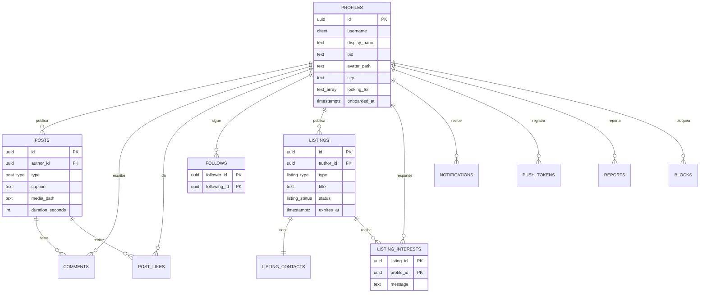

# Modelo de datos

> Versión 0.1 · 18/10/2026
> Motor: PostgreSQL 15+ (Supabase). Esquema `public`, auth en `auth.users`.

## 1. Convenciones

- Claves primarias `uuid` con `gen_random_uuid()` salvo catálogos (`smallint identity`).
- Fechas `timestamptz` en UTC; la UI muestra `America/Montevideo`.
- Borrado lógico (`deleted_at`) en contenido social; borrado físico en cuenta y datos personales.
- Nombres de tablas y columnas en inglés, `snake_case`, plural para tablas.
- Enums de Postgres para valores cerrados; catálogos en tablas para valores editables.
- Toda tabla nueva nace con RLS activo y sin políticas (default deny).

## 2. Diagrama entidad-relación



## 3. Enums

```sql
create type skill_level as enum ('beginner', 'intermediate', 'advanced');
create type post_type as enum ('cover', 'photo', 'text');
create type listing_type as enum (
  'looking_for_member',
  'looking_for_band',
  'looking_for_producer',
  'offering_production',
  'offering_lessons',
  'looking_for_lessons'
);
create type listing_status as enum ('open', 'closed', 'expired');
create type notification_type as enum (
  'follow', 'like', 'comment',
  'listing_interest', 'listing_response', 'system'
);
create type report_target as enum ('post', 'comment', 'profile', 'listing');
create type report_reason as enum (
  'spam', 'harassment', 'nudity', 'violence', 'copyright', 'other'
);
create type report_status as enum ('pending', 'reviewed', 'actioned', 'dismissed');
```

## 4. Tablas

### 4.1 Identidad y perfil

```sql
create extension if not exists citext;
create extension if not exists pg_trgm;

create table instruments (
  id smallint generated always as identity primary key,
  slug text not null unique,
  name text not null
);

create table genres (
  id smallint generated always as identity primary key,
  slug text not null unique,
  name text not null
);

create table profiles (
  id uuid primary key references auth.users(id) on delete cascade,
  username citext not null unique,
  display_name text not null,
  bio text,
  avatar_path text,
  city text not null default 'Montevideo',
  country text not null default 'UY',
  looking_for text[] not null default '{}',
  onboarded_at timestamptz,
  created_at timestamptz not null default now(),
  updated_at timestamptz not null default now(),
  deleted_at timestamptz,
  constraint username_format check (username ~ '^[a-z0-9_]{3,20}$'),
  constraint display_name_len check (char_length(display_name) between 2 and 40),
  constraint bio_len check (bio is null or char_length(bio) <= 160),
  constraint looking_for_valid check (
    looking_for <@ array['banda','integrantes','productor','clases','shows']::text[]
  )
);

create table profile_instruments (
  profile_id uuid not null references profiles(id) on delete cascade,
  instrument_id smallint not null references instruments(id),
  level skill_level not null default 'intermediate',
  primary key (profile_id, instrument_id)
);

create table profile_genres (
  profile_id uuid not null references profiles(id) on delete cascade,
  genre_id smallint not null references genres(id),
  primary key (profile_id, genre_id)
);
```

`profiles` se crea con un trigger desde `auth.users` para garantizar que todo usuario autenticado tenga perfil. El onboarding completa `username`, `display_name`, instrumentos y géneros.

### 4.2 Red social

```sql
create table follows (
  follower_id uuid not null references profiles(id) on delete cascade,
  following_id uuid not null references profiles(id) on delete cascade,
  created_at timestamptz not null default now(),
  primary key (follower_id, following_id),
  constraint no_self_follow check (follower_id <> following_id)
);

create table posts (
  id uuid primary key default gen_random_uuid(),
  author_id uuid not null references profiles(id) on delete cascade,
  type post_type not null,
  caption text,
  media_path text,
  thumbnail_path text,
  duration_seconds integer,
  instrument_id smallint references instruments(id),
  genre_id smallint references genres(id),
  city text,
  like_count integer not null default 0,
  comment_count integer not null default 0,
  created_at timestamptz not null default now(),
  updated_at timestamptz not null default now(),
  deleted_at timestamptz,
  constraint caption_len check (caption is null or char_length(caption) <= 500),
  constraint cover_has_media check (
    type <> 'cover' or (media_path is not null and duration_seconds between 1 and 60)
  ),
  constraint photo_has_media check (type <> 'photo' or media_path is not null),
  constraint text_has_no_media check (type <> 'text' or media_path is null)
);

create table post_likes (
  post_id uuid not null references posts(id) on delete cascade,
  profile_id uuid not null references profiles(id) on delete cascade,
  created_at timestamptz not null default now(),
  primary key (post_id, profile_id)
);

create table comments (
  id uuid primary key default gen_random_uuid(),
  post_id uuid not null references posts(id) on delete cascade,
  author_id uuid not null references profiles(id) on delete cascade,
  body text not null,
  created_at timestamptz not null default now(),
  deleted_at timestamptz,
  constraint body_len check (char_length(body) between 1 and 300)
);

create table saved_posts (
  profile_id uuid not null references profiles(id) on delete cascade,
  post_id uuid not null references posts(id) on delete cascade,
  created_at timestamptz not null default now(),
  primary key (profile_id, post_id)
);
```

Los contadores (`like_count`, `comment_count`) se mantienen con triggers para evitar `count(*)` en cada feed. Son denormalización deliberada y deben poder recalcularse.

### 4.3 Avisos

```sql
create table listings (
  id uuid primary key default gen_random_uuid(),
  author_id uuid not null references profiles(id) on delete cascade,
  type listing_type not null,
  title text not null,
  description text not null,
  instrument_id smallint references instruments(id),
  genre_id smallint references genres(id),
  zone text,
  band_name text,
  status listing_status not null default 'open',
  expires_at timestamptz not null default (now() + interval '30 days'),
  created_at timestamptz not null default now(),
  updated_at timestamptz not null default now(),
  closed_at timestamptz,
  constraint title_len check (char_length(title) between 6 and 80),
  constraint description_len check (char_length(description) between 20 and 600),
  constraint band_name_len check (band_name is null or char_length(band_name) between 2 and 40)
);

-- El contacto se guarda aparte para poder ocultarlo hasta que haya interés.
create table listing_contacts (
  listing_id uuid primary key references listings(id) on delete cascade,
  contact_type text not null check (contact_type in ('whatsapp', 'instagram', 'email')),
  contact_value text not null,
  created_at timestamptz not null default now()
);

create table listing_interests (
  listing_id uuid not null references listings(id) on delete cascade,
  profile_id uuid not null references profiles(id) on delete cascade,
  message text,
  created_at timestamptz not null default now(),
  primary key (listing_id, profile_id),
  constraint interest_message_len check (message is null or char_length(message) <= 300)
);
```

Regla: máximo 3 avisos con `status = 'open'` por usuario, validada en trigger. `expires_at` se procesa con `pg_cron` una vez por día.

### 4.4 Notificaciones y confianza

```sql
create table notifications (
  id uuid primary key default gen_random_uuid(),
  recipient_id uuid not null references profiles(id) on delete cascade,
  actor_id uuid references profiles(id) on delete set null,
  type notification_type not null,
  post_id uuid references posts(id) on delete cascade,
  listing_id uuid references listings(id) on delete cascade,
  comment_id uuid references comments(id) on delete cascade,
  read_at timestamptz,
  created_at timestamptz not null default now()
);

create table push_tokens (
  profile_id uuid not null references profiles(id) on delete cascade,
  token text not null,
  platform text not null check (platform in ('ios', 'android')),
  updated_at timestamptz not null default now(),
  primary key (profile_id, token)
);

create table reports (
  id uuid primary key default gen_random_uuid(),
  reporter_id uuid not null references profiles(id) on delete cascade,
  target_type report_target not null,
  target_id uuid not null,
  target_author_id uuid references profiles(id) on delete set null,
  reason report_reason not null,
  details text,
  status report_status not null default 'pending',
  created_at timestamptz not null default now(),
  reviewed_at timestamptz,
  reviewed_by uuid references profiles(id) on delete set null,
  constraint details_len check (details is null or char_length(details) <= 500)
);

create table blocks (
  blocker_id uuid not null references profiles(id) on delete cascade,
  blocked_id uuid not null references profiles(id) on delete cascade,
  created_at timestamptz not null default now(),
  primary key (blocker_id, blocked_id),
  constraint no_self_block check (blocker_id <> blocked_id)
);
```

`reports.target_id` es polimórfico a propósito: no lleva FK porque puede apuntar a cuatro tablas. Se guarda `target_author_id` para conservar contexto si el contenido se borra.

## 5. RLS

Matriz resumida (todas las políticas aplican a `authenticated`):

| Tabla | SELECT | INSERT | UPDATE | DELETE |
| --- | --- | --- | --- | --- |
| `profiles` | Todos los perfiles no borrados | Solo el trigger (o el propio `id`) | Solo el propio | No (borrado lógico) |
| `profile_instruments` / `profile_genres` | Todos | Solo el propio perfil | Solo el propio | Solo el propio |
| `follows` | Todos | Solo `follower_id = auth.uid()` | No | Solo el propio follow |
| `posts` | No borrados, autor no bloqueado | Solo `author_id = auth.uid()` | Solo el propio | Solo el propio (lógico) |
| `post_likes` | Todos | Solo `profile_id = auth.uid()` | No | Solo el propio |
| `comments` | No borrados, autor no bloqueado | Solo `author_id = auth.uid()` | Solo el propio | Solo el propio |
| `saved_posts` | Solo el propio | Solo el propio | No | Solo el propio |
| `listings` | Todos los no vencidos o propios | Solo `author_id = auth.uid()` | Solo el propio | Solo el propio (cerrar) |
| `listing_contacts` | Autor del aviso o perfil con interés | Solo el autor del aviso | Solo el autor | Solo el autor |
| `listing_interests` | Propio o autor del aviso | Solo `profile_id = auth.uid()` | No | Solo el propio |
| `notifications` | Solo `recipient_id = auth.uid()` | No (solo triggers) | Solo el propio (`read_at`) | No |
| `push_tokens` | Solo el propio | Solo el propio | Solo el propio | Solo el propio |
| `reports` | Solo el propio | Solo el propio | No | No |
| `blocks` | Solo el propio | Solo el propio | No | Solo el propio |

El bloqueo es **bidireccional a nivel de producto**: si A bloquea a B, ninguno ve el contenido del otro. Para que la política no dependa de leer `blocks` bajo RLS, se usa una función `security definer`:

```sql
create or replace function is_blocked(a uuid, b uuid)
returns boolean
language sql
stable
security definer
set search_path = public
as $$
  select exists (
    select 1 from blocks
    where (blocker_id = a and blocked_id = b)
       or (blocker_id = b and blocked_id = a)
  );
$$;

create policy "posts visibles"
on posts for select to authenticated
using (
  deleted_at is null
  and not is_blocked(auth.uid(), posts.author_id)
);
```

Las políticas de escritura siempre incluyen `auth.uid()`; ninguna confía en un `author_id` enviado por el cliente. La misma función se usa en el feed, la búsqueda y el perfil.

## 6. Storage

| Bucket | Contenido | Lectura | Escritura |
| --- | --- | --- | --- |
| `avatars` | Fotos de perfil | Pública | Solo `avatars/{uid}/...` |
| `covers` | Videos de covers y portadas | Pública | Solo `covers/{uid}/...` |
| `photos` | Fotos de shows y crónicas | Pública | Solo `photos/{uid}/...` |

Política tipo:

```sql
create policy "subir avatar propio"
on storage.objects for insert to authenticated
with check (
  bucket_id = 'avatars'
  and (storage.foldername(name))[1] = auth.uid()::text
);
```

La lectura pública simplifica el feed y el CDN. Los nombres son UUID; no se listan carpetas desde el cliente. Al borrar un post o una cuenta, una Edge Function elimina los objetos asociados.

## 7. Índices

```sql
create index posts_feed_idx on posts (created_at desc, id desc) where deleted_at is null;
create index posts_author_idx on posts (author_id, created_at desc) where deleted_at is null;
create index posts_city_idx on posts (city, created_at desc) where deleted_at is null;
create index comments_post_idx on comments (post_id, created_at) where deleted_at is null;
create index follows_follower_idx on follows (follower_id);
create index follows_following_idx on follows (following_id);
create index listings_open_idx on listings (status, created_at desc);
create index listings_type_idx on listings (type, status);
create index listings_expires_idx on listings (expires_at);
create index notifications_recipient_idx on notifications (recipient_id, read_at, created_at desc);
create index reports_status_idx on reports (status, created_at);
create index profiles_username_trgm_idx on profiles using gin ((username::text) gin_trgm_ops);
create index profiles_name_trgm_idx on profiles using gin (display_name gin_trgm_ops);
```

## 8. Funciones y triggers

| Trigger / función | Qué hace |
| --- | --- |
| `handle_new_user` | Crea `profiles` al registrarse, con username provisional y datos del proveedor. |
| `set_updated_at` | Actualiza `updated_at` en `profiles`, `posts`, `listings`. |
| `on_post_like` | Incrementa/decrementa `like_count` e inserta notificación. |
| `on_comment` | Incrementa/decrementa `comment_count` e inserta notificación. |
| `on_follow` | Actualiza contadores e inserta notificación. |
| `on_listing_interest` | Inserta notificación para el autor del aviso. |
| `is_blocked(a, b)` | Devuelve true si hay bloqueo en cualquier dirección (`security definer`). |
| `enforce_listing_limit` | Rechaza un cuarto aviso abierto del mismo autor. |
| `expire_listings` | Pasa a `expired` los avisos vencidos (pg_cron diario). |
| `delete_account` | Edge Function: borra cuenta, perfil, contenido y medios (service role). |

## 9. Datos semilla

**Instrumentos**: guitarra, bajo, batería, voz, piano, teclado, sintetizador, violín, viola, violonchelo, contrabajo, flauta, saxo, trompeta, trombón, clarinete, percusión, armónica, ukelele, otros.

**Géneros**: rock, pop, indie, punk, metal, hip hop, rap, trap, cumbia, reggae, ska, jazz, blues, funk, soul, electrónica, house, techno, folclore, tango, murga, candombe, clásica, experimental, otros.

Los catálogos se cargan en `supabase/seed.sql` y se pueden ampliar sin migración.

## 10. Estrategia de migraciones

1. `0001_extensiones_y_catalogos.sql`: extensiones, enums, `instruments`, `genres`, seed.
2. `0002_perfiles.sql`: `profiles`, joins, trigger de alta.
3. `0003_contenido_social.sql`: `posts`, `post_likes`, `comments`, `saved_posts`, `follows`.
4. `0004_avisos.sql`: `listings`, `listing_contacts`, `listing_interests`.
5. `0005_notificaciones_y_confianza.sql`: `notifications`, `push_tokens`, `reports`, `blocks`.
6. `0006_rls.sql`: políticas de todas las tablas y storage.
7. `0007_triggers_e_indices.sql`: contadores, notificaciones, límites, índices, cron.

Reglas: migraciones inmutables una vez aplicadas en producción; cambios con una migración nueva; `supabase db diff` para verificar que el esquema remoto coincide.
